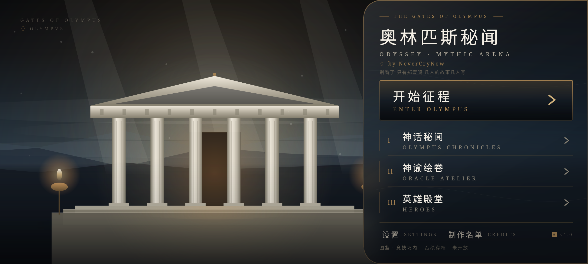
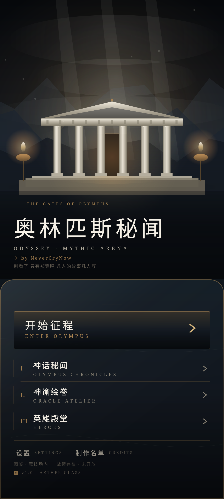
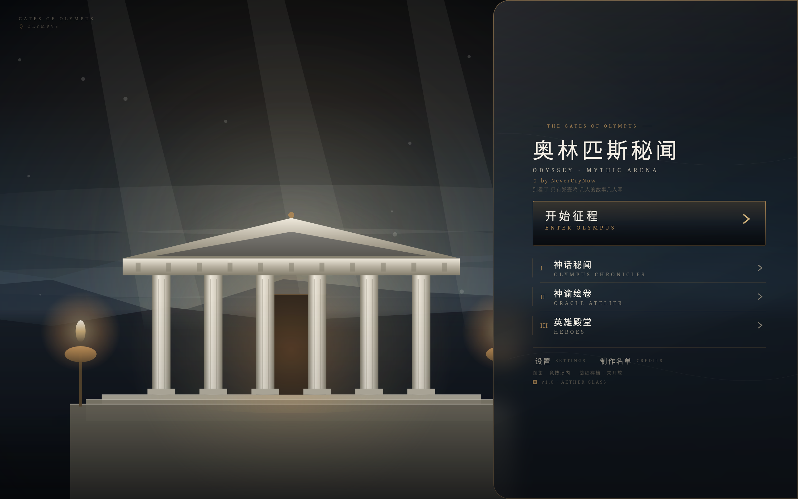
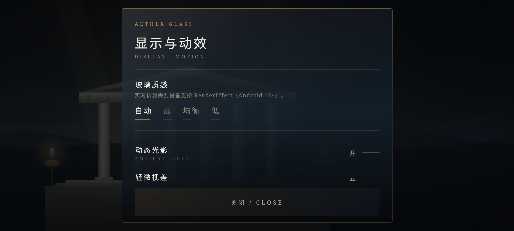
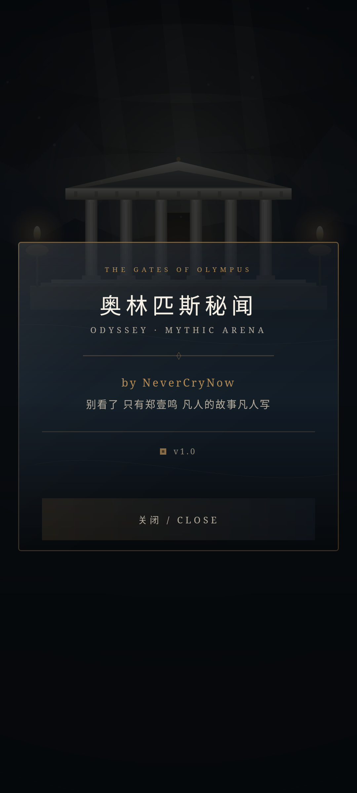

# ODYSSEY · MYTHIC ARENA — THE GATES OF OLYMPUS

[](https://github.com/zym1233211231-ctrl/Ncns-ODS/actions/workflows/homeui.yml)

A buildable Jetpack Compose reconstruction of the home screen of a decompiled Android game
(`com.hextech.aram`), built on top of the APK — the original Kotlin/Gradle project is lost.

The home screen was decompiled bytecode. It is now a real Compose source module
(`homeui/`) that compiles with Kotlin 2.1 + Compose 1.7, ships as `classes3.dex`, and keeps
the original `LauncherScreen(String, () -> Unit, () -> Unit, () -> Unit)` call contract.





## Highlights

- **Golden-ratio landscape** — 61.8% temple / 38.2% gate panel.
- **Independent portrait layout** — temple above, glass sheet with the gates below; not a
  squeezed landscape.
- **AETHER GLASS** — background transmission + slight refraction on API 31+, with two real
  fallbacks (light blur / gradient + edge highlight). No fake blur.
- **Canvas temple scene** — mountains, clouds, colonnade, pediment, steps, torches, god rays,
  dust and vignette, drawn from code (no bitmap assets).
- **Native navigation** — arena, chronicles and atelier callbacks are unchanged; settings and
  credits are real sheets; unavailable destinations are labelled instead of faked.
- **Static checks in CI** — GitHub Actions compiles the module and asserts the exact
  composable JVM signature; no 622 MB baseline APK needed.

## Screens

| Landscape | Portrait | Tablet |
| --- | --- | --- |
| 61.8 / 38.2 split, full-height glass panel | temple + bottom sheet | content capped at 430 dp |



Glass panels and the two sheet states:





> Screenshots are rendered from the **same Kotlin sources** by `homeui/preview/` on desktop
> Compose 1.7 (only Android-only `HomeSettings`/`LocalView`/`BackHandler` are stubbed).
> They are not device screenshots — see the verification notes.

## Build the home module

```bash
export ANDROID_JAR=/path/to/android-33/android.jar
JAVA_HOME=/path/to/jdk21 ./homeui/toolchain/setup.sh   # once, pinned versions
./homeui/build-home.sh                                  # -> build/dex/classes3.dex
javap -p -cp build/homeui/classes com.hextech.aram.LauncherScreenKt
```

The full APK build additionally needs the untracked `base/current-v9.apk` + `tools/`:

```bash
./build.sh              # homeui -> classes3.dex, then classes2, zipalign, apksigner
BUILD_HOMEUI=0 ./build.sh   # skip the Compose module
```

## Repository scope

This repo tracks source, build scripts and documentation. The 8 GB working tree stays out:

| Path | Size | Why not here |
| --- | --- | --- |
| `base/*.apk` | 1.3 GB | 622 MB per file, over GitHub's 100 MB file limit |
| `smali/` | 149 MB | decompiled bytecode, regenerable |
| `jadx/` | 277 MB | decompiled Java reference, regenerable |
| `tools/` | 890 MB | smali/SDK toolchain |
| `build/` | 8 GB | generated APKs/dex |
| `sign/oracle.keystore` | — | signing secret, never uploaded |

Restore `base/` and `tools/` locally to rebuild the APK; the produced APK is distributed
separately. `.gitignore` enforces all of the above.

## Documentation

- [`docs/HOME-REBUILD.md`](docs/HOME-REBUILD.md) — design, glass tiers, navigation mapping,
  verification numbers and known gaps.
- [`docs/ARCHITECTURE.md`](docs/ARCHITECTURE.md) — original workspace / dex layout notes.
- [`homeui/preview/README.md`](homeui/preview/README.md) — desktop render harness.

## Status

Compiled, signed and zip-aligned locally; dex reference audit: 89 classes, 746 method
references, 0 missing, 0 duplicate against `classes.dex`/`classes2.dex`. On-device install
was not possible in the build environment (no adb/emulator, Shizuku unauthorized) — see the
risk list in `docs/HOME-REBUILD.md`.


---

## APK reconstruction workspace

## Workspace layout
- `base/oracle-original.apk` — untouched original (622 MB, classes2 + assets).
- `base/current-v9.apk` — latest working build (v9 credits, performance, myth AI cache).
- `smali/classes2/` — classes2.dex sources: MainActivity, Oracle Atelier, myth UI, AI engine, game.
  The home screen no longer lives here (see `homeui/`).
- `smali/classes1/` — classes.dex sources: renderer/game core.
- `jadx/sources/` — decompiled Java reference (read-only; not directly buildable).
- `assets/models/` — ONNX + tokenizer; `assets/from-apk/` — illustrations/story if extracted.
- `tools/apktool-tools` — smali/baksmali/jcommander; `sign/oracle.keystore`.
- `patch-src/` — Java overrides for AI engine (compiled via javac/D8).
- `feature-src/` — Java overrides for AI art/ARAM fixes.
- `homeui/` — **buildable Compose source module for the home screen** (`LauncherScreenKt`),
  compiled to `classes3.dex` and packaged automatically by `build.sh`.
- `docs/HOME-REBUILD.md` — THE GATES OF OLYMPUS redesign notes, verification and gaps.
- `docs/preview/` — desktop renders of the real home composables (landscape / portrait / tablet / sheets).

## Full APK build

`./build.sh` also assembles classes2 and repackages/signs the APK (the parts below need the
untracked baseline + tools):

```bash
./build.sh                    # classes2 + homeui classes3.dex, default base current-v9
BUILD_CLASSES1=1 ./build.sh   # also rebuild classes.dex (slow)
BUILD_ASSETS=1 ./build.sh     # also refresh ONNX models
BUILD_HOMEUI=0 ./build.sh     # skip the Compose home module
```

Output: `build/odyssey-*-signed.apk`.
Signing: `oracle.keystore`, alias `oracle`, store/key password `oracle2026`.
Do **not** lose this keystore; updating the installed app depends on it.

## Key files
- Home UI: `homeui/src/com/hextech/aram/LauncherScreen.kt` + `homeui/src/com/hextech/aram/olympus/`
  (old smali kept in `smali-removed/launcher-v9/` for reference)
- MainActivity: `smali/classes2/com/hextech/aram/MainActivity*.smali`
- AI art UI: `smali/classes2/com/hextech/aram/aiart/`
- Myth/story UI: `smali/classes2/com/olympus/chronicles/`
- AI engine source: `patch-src/src/com/olympus/chronicles/ai/`
- ONNX model: `assets/models/` (tiny-SD)
- Story: extract from `base/*.apk` `assets/story/`
- Illustrations: `assets/from-apk/illustrations/`

## Known state
- v9: credits added, AI cache bridge, prompt v2, adaptive performance.
- Myth AI: generation requires enabling local AI + autoOnEvents; results cache into `ChronicleApp.bitmaps`.
- ARAM stable: no BotBrain/Fx/high-poly GLB in current base.
- Known limitation: tiny-SD 512 quality; high-quality weights absent.
- Home UI: THE GATES OF OLYMPUS refactor implemented in `homeui/` (golden-ratio split,
  AETHER GLASS with three real performance tiers, portrait bottom sheet, staggered entrance,
  settings + credits sheets). See `docs/HOME-REBUILD.md`. Not yet verified on a device
  (no adb/emulator; Shizuku unauthorized).

## Refactor workflow
1. Edit smali or Java override.
2. `./build.sh`.
3. Install with same signature over previous build.
4. Large UI work goes in `homeui/` (Compose source), not into smali; `build.sh` packages it
   as `classes3.dex`. Run `homeui/preview/render.sh` for desktop layout screenshots.
